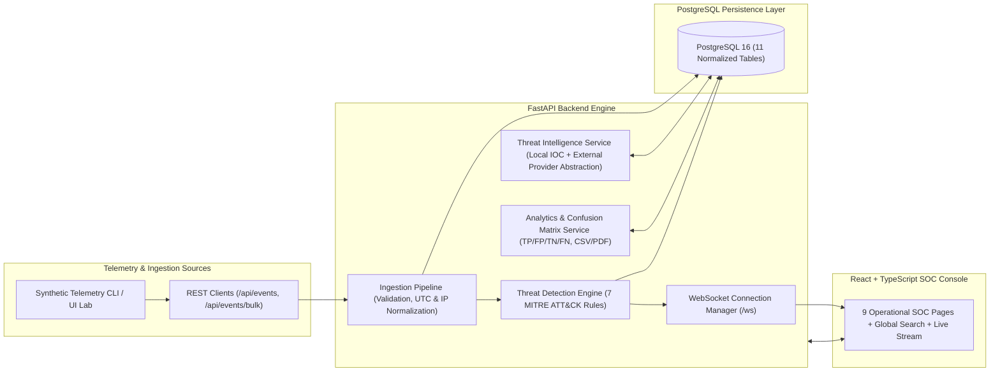

# ThreatLens — System & Security Architecture

## 1. High-Level Architecture Overview

---

## 2. Database Schema Design (11 Normalized Tables)

All tables include `id` primary keys, indexed lookup columns, foreign key constraints with appropriate `ON DELETE` rules, and timezone-aware `created_at` and `updated_at` timestamps managed via SQLAlchemy 2.0 and Alembic (`0001_initial_schema.py`):

1. **`users`**: Stores operator credentials (`bcrypt` 12-round hashes), roles (`admin`, `soc_lead`, `analyst`), active flags, and `last_login` timestamps.
2. **`security_events`**: Stores normalized telemetry (`event_id`, `timestamp`, `source_ip`, `destination_ip`, `destination_port`, `username`, `hostname`, `event_type`, `event_category`, `action`, `status`, `severity`, `raw_log`, `metadata`, `is_synthetic`). Composite indexes optimize time-window correlation queries (`(source_ip, username, timestamp)` and `(event_category, timestamp)`).
3. **`detection_rules`**: Stores the 7 configurable detection rules (`rule_id`, `rule_key`, `threshold_count`, `time_window_seconds`, `parameters`, `severity`, `enabled`, `mitre_tactic`, `mitre_technique_id`, `mitre_technique_name`).
4. **`alerts`**: Stores generated alerts with `first_seen`, `last_seen`, `event_count`, `dedup_key` (preventing duplicate alerts within the same active correlation window), `evidence_summary`, and `status`.
5. **`alert_evidence`**: Many-to-many join table linking each `Alert` to its triggering `SecurityEvent` records (`uq_alert_evidence_pair`).
6. **`alert_status_history`**: Immutable audit trail of every status transition (`New` -> `Acknowledged` -> `Investigating` -> `Resolved` / `False Positive`) with actor and comment.
7. **`incidents`**: Stores incident investigations (`incident_id`, `title`, `severity`, `status`, `assigned_analyst`, `timeline_events`, `evidence_references`, `resolution_summary`, `resolved_at`).
8. **`incident_alerts`**: Many-to-many join table associating multiple `Alert` records with an `Incident` (`uq_incident_alert_pair`).
9. **`investigation_notes`**: Analyst forensic notes attached to either an `Alert` or an `Incident`.
10. **`threat_indicators`**: Indicator of Compromise (IOC) repository (`indicator_type`, `indicator_value`, `threat_type`, `severity`, `confidence`, `source`, `tags`, `hit_count`).
11. **`audit_logs`**: Platform-wide audit trail recording logins, rule changes, alert triage updates, incident actions, IOC updates, and simulation executions.

---

## 3. Detection Engine Correlation Logic & Deduplication

When events are ingested via `EventIngestionPipeline`, they are sorted chronologically and evaluated against all enabled `DetectionRule` rows:

| Rule ID | Rule Key | MITRE Mapping | Correlation Window & Logic |
| :--- | :--- | :--- | :--- |
| `RULE-001` | `brute_force` | `T1110.001` (Credential Access) | Groups `Authentication` events with `status='failure'` by `(source_ip, username)` within `time_window_seconds` (default 300s). Fires when count $\ge$ `threshold_count` (default 5). |
| `RULE-002` | `password_spraying` | `T1110.003` (Credential Access) | Groups `Authentication` failures by `source_ip` within window (default 600s). Fires when distinct targeted usernames $\ge$ `threshold_count` (default 4) while per-user attempts remain low ($\le 3$). |
| `RULE-003` | `login_after_failures` | `T1078` (Initial Access) | On `Authentication` `status='success'`, queries preceding `status='failure'` events for the same `(source_ip, username)` within window. Fires if preceding failures $\ge$ `threshold_count` (default 3) and links both failure and compromise events. |
| `RULE-004` | `unusual_login` | `T1078.004` (Initial Access) | Evaluates `Authentication` `status='success'` events for non-RFC1918 source IPs during off-hours UTC windows, active IOC matches, or explicit anomaly telemetry flags without assuming unverified geolocation. |
| `RULE-005` | `privilege_escalation` | `T1548` (Privilege Escalation) | Matches `Authorization`, `Endpoint`, or `System` events exhibiting `sudo_abuse`, `privilege_escalation`, `setuid_execution`, or elevation to `root`/`SYSTEM`/`Domain Admins`. |
| `RULE-006` | `port_scanning` | `T1046` (Discovery) | Groups `Network` events by `source_ip` within window (default 120s). Fires when distinct `destination_port` count $\ge$ `threshold_count` (default 8). |
| `RULE-007` | `suspicious_network` | `T1071` (Command and Control) | Matches `Network` events connecting to configured C2 ports (`4444, 1337, 6667, 9001, 31337`), exceeding `exfil_bytes_threshold` (10 MB), matching `c2_beacon`/`dns_tunneling`, or communicating with active IOCs. |

### Window Deduplication
Each candidate detection generates a deterministic `dedup_key` (e.g., `bf:<source_ip>:<username>`). If an alert for that `(rule_code, dedup_key)` already exists whose `last_seen` is within `time_window_seconds` of the new event, the engine updates the existing alert's `last_seen` timestamp, links the new `AlertEvidence` record, and updates `event_count` rather than generating duplicate alert noise.

---

## 4. Real-Time Streaming & Polling Fallback Architecture

1. **WebSocket Stream (`/ws`, `/api/ws`)**:
   - Managed by `ConnectionManager` (`backend/app/core/websocket.py`).
   - Supports optional `?token=<JWT>` authentication, `ping`/`pong` heartbeats, and `{"type": "sync", "since_seq": <n>}` catch-up snapshots.
   - Uses thread-safe `asyncio.run_coroutine_threadsafe` scheduling so synchronous FastAPI endpoints broadcast `event_ingested`, `bulk_events_ingested`, `alert_created`, `alert_status_updated`, `incident_created`, `incident_updated`, and `dashboard_metrics_updated` immediately.
2. **Automatic HTTP Polling Fallback (`/api/system/realtime/poll`)**:
   - Every broadcast message is assigned a monotonic sequence number (`seq`) and stored in a thread-safe ring buffer.
   - If the browser's WebSocket connection drops or is blocked by an intermediary proxy, `useRealtimeStream.ts` automatically transitions to `polling_fallback` mode and polls `/api/system/realtime/poll?since_seq=<last_seq>` without losing events or dashboard metric updates.

---

## 5. Security Controls & Defense-in-Depth

- **Authentication & JWT Verification**: Passwords hashed with 12-round `bcrypt` (`backend/app/core/security.py`). JWT access tokens enforce `sub`, `exp`, `iat`, and `type="access"` claims (`GET /api/auth/verify`).
- **Role-Based Access Control (RBAC)**: Supports `admin`, `soc_lead`, `analyst`, and `viewer` roles (`backend/app/api/deps.py`). Unauthorized write attempts return `403 Forbidden` and automatically record an `rbac_access_denied` (`status="failure"`) entry in `audit_logs`.
- **Sliding-Window API Rate Limiting**: `SlidingWindowRateLimiter` (`backend/app/core/rate_limit.py`) protects `/api/auth/login`, `/api/events`, `/api/threat-intelligence/lookup`, and `/api/reports/export/*`, returning HTTP `429 Too Many Requests` with `Retry-After`, `X-RateLimit-Limit`, and `X-RateLimit-Remaining` headers.
- **Strict Input Validation**: Pydantic v2 schemas validate IPv4/IPv6 addresses, CIDR blocks, port ranges (`1..65535`), username character sets, and control-character stripping before any database interaction.

