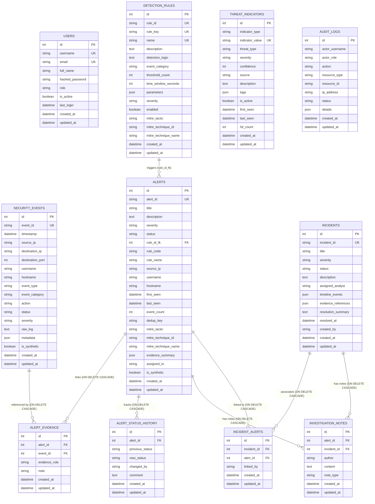

# ThreatLens — PostgreSQL Database Schema & Migration Reference

## 1. Entity-Relationship Diagram (11 Normalized Tables)



---

## 2. Foreign Keys & Referential Integrity Constraints

| Child Table | Column | Parent Table | `ON DELETE` Policy | Uniqueness Constraint |
| :--- | :--- | :--- | :--- | :--- |
| `alerts` | `rule_id_fk` | `detection_rules.id` | `SET NULL` | `ix_alerts_alert_id` (Unique) |
| `alert_evidence` | `alert_id` | `alerts.id` | `CASCADE` | `uq_alert_evidence_pair (alert_id, event_id)` |
| `alert_evidence` | `event_id` | `security_events.id` | `CASCADE` | `uq_alert_evidence_pair (alert_id, event_id)` |
| `alert_status_history` | `alert_id` | `alerts.id` | `CASCADE` | — |
| `incident_alerts` | `incident_id` | `incidents.id` | `CASCADE` | `uq_incident_alert_pair (incident_id, alert_id)` |
| `incident_alerts` | `alert_id` | `alerts.id` | `CASCADE` | `uq_incident_alert_pair (incident_id, alert_id)` |
| `investigation_notes` | `alert_id` | `alerts.id` | `CASCADE` | — |
| `investigation_notes` | `incident_id` | `incidents.id` | `CASCADE` | — |

---

## 3. Database Indexes (`0001_initial_schema.py`)

| Table | Index Name | Indexed Columns | Purpose |
| :--- | :--- | :--- | :--- |
| `users` | `ix_users_username` (Unique) | `(username)` | Fast authentication lookup |
| `users` | `ix_users_email` (Unique) | `(email)` | Operator email uniqueness |
| `users` | `ix_users_role` | `(role)` | Role filtering |
| `security_events` | `ix_security_events_event_id` (Unique) | `(event_id)` | Idempotent event lookup |
| `security_events` | `ix_security_events_timestamp` | `(timestamp)` | Time-series sorting & windowing |
| `security_events` | `ix_security_events_source_ip` | `(source_ip)` | IP correlation & explorer filtering |
| `security_events` | `ix_security_events_cat_ts` | `(event_category, timestamp)` | Category time-window queries |
| `security_events` | `ix_security_events_src_user_ts` | `(source_ip, username, timestamp)` | Brute-force & login-after-failure correlation |
| `detection_rules` | `ix_detection_rules_rule_id` (Unique) | `(rule_id)` | Rule lookup by code (`RULE-001`..`RULE-007`) |
| `detection_rules` | `ix_detection_rules_rule_key` (Unique) | `(rule_key)` | Engine evaluator binding |
| `alerts` | `ix_alerts_alert_id` (Unique) | `(alert_id)` | Alert code lookup |
| `alerts` | `ix_alerts_status_sev` | `(status, severity)` | SOC queue triage filtering |
| `alerts` | `ix_alerts_rule_dedup` | `(rule_code, dedup_key)` | In-window deduplication lookup |
| `alert_evidence` | `ix_alert_evidence_alert_id` | `(alert_id)` | Alert evidence retrieval |
| `alert_evidence` | `ix_alert_evidence_event_id` | `(event_id)` | Reverse event-to-alert lookup |
| `alert_status_history` | `ix_alert_status_history_alert_id` | `(alert_id)` | Alert audit timeline query |
| `incidents` | `ix_incidents_incident_id` (Unique) | `(incident_id)` | Incident code lookup |
| `threat_indicators` | `ix_threat_indicators_indicator_value` (Unique) | `(indicator_value)` | Real-time IOC matching during ingestion & lookup |

---

## 4. Alembic Migration Commands

```bash
cd backend

# Check current migration revision applied to PostgreSQL
python -m alembic current

# Apply all migrations up to head
python -m alembic upgrade head

# Roll back one migration revision (development/testing only)
python -m alembic downgrade -1
```

